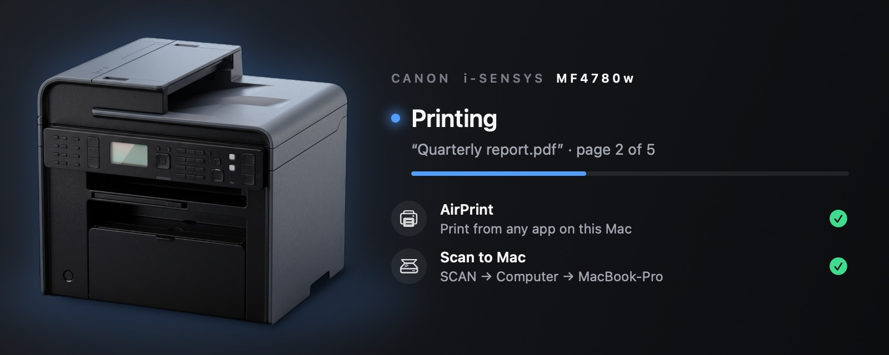

# mf4700-print-scan

Print and scan from a Mac with a Canon i-SENSYS / imageCLASS **MF4700 series**
printer (MF4780w, MF4770n, MF4750, MF4730, MF4720w) without installing a driver.
These printers only speak Canon's proprietary **UFR II LT** language.



**Canon MF4780w Print & Scan.app** is self-contained. While it is open, this Mac has an
AirPrint printer "Canon MF4780w", and anything you scan on the MF lands as a PDF on
your Desktop and opens. Quitting it stops both.

**[Download the latest release](https://github.com/pkhr/mf4700-print-scan/releases/latest)**:
a disk image with the app, for macOS 14 or later on Apple silicon or Intel. The app
reaches the printer over the network (Wi-Fi or Ethernet); USB is not supported. It
was developed with an MF4780w on macOS 27.

Not made or endorsed by Canon; see [License](#license).

```
any app → macOS AirPrint driver → localhost:8631 (ippeveprinter, started by the app)
        → rastertoufr2lt (bundled encoder) → /usr/bin/nc → Canon :9100
```

* **This Mac only.** The app runs macOS's built-in `/usr/bin/ippeveprinter` bound to
  127.0.0.1/::1 and advertises it with a *local-only* Bonjour registration. Nothing
  is offered on the network.
* **Nothing installed.** It needs no drivers, admin rights or background services.
  State lives in `~/Library/Application Support/Canon MF4780w Print & Scan` (printer
  UUID, spool) and `~/Library/Logs/Canon MF4780w Print & Scan.log`.
* **Byte-identical to Canon.** `rastertoufr2lt` is an open UFR II LT encoder,
  reverse-engineered from Canon's driver; see [FORMAT.md](FORMAT.md).
* **Status.** The app finds the printer via Bonjour (`CanonMF4700`, so IP changes
  don't matter) and shows paper-out, jam, cover and toner problems from SNMP. macOS's
  print queue shows them too.

## Use

1. Open the disk image, drag **Canon MF4780w Print & Scan** to Applications and open
   it. The app is not notarized, so macOS blocks the first launch: click **Open
   Anyway** in System Settings → Privacy & Security, then open it again. Allow it to
   find devices on your local network when macOS asks.
2. The first time, click **Add to Mac** in its panel, or add "Canon MF4780w" in
   System Settings → Printers & Scanners.
3. Print from any app. Keep the app running while printing. Jobs sent while it is
   closed wait in the queue and print when you open it.

The panel shows the printer and what it is doing: printing (with page progress),
scanning, asleep, paper jam, out of paper. Closing the panel keeps the app running
in the menu bar only; its Dock icon returns with the panel (menu bar → Show, or
open the app again). The menu-bar
icon follows the printer's state, and its menu shows the status and toner level,
opens the last scan, switches **Open at Login** on or off, and quits the app.
Opened at login, the app starts in the menu bar without its window. While a job prints, macOS 27's Print Center
shows its own printer icon in the menu bar (a Live Activity), so the app's icon
steps aside until the job is done.

Paper sizes: A4 (default), Letter, Legal, A5, B5, Executive, Statement, Foolscap,
16K, index cards, Hagaki, and #10/DL/C5/Monarch envelopes. Mono, 600 dpi, copies,
and collation are supported.

Different printer address:
`defaults write local.mf4700-airprint PrinterURI "socket://192.168.1.20:9100"`.
The default is `dnssd://CanonMF4700 dnssd://*`: the printer's Bonjour name, else the
first MF4700-series printer on the network (other printers are skipped by their
SNMP description).

## Scanning

Put pages on the glass or in the feeder, then on the printer press
**SCAN → Computer → *this Mac's name*** and pick **Color Scan**
or **B&W Scan**. The app scans every page (the feeder if it has paper, otherwise
the glass, 300 dpi, colour or grayscale) and saves `Scan <date> at <time>.pdf` on
the Desktop, then opens it. A chime sounds when the PDF is saved. macOS asks once
whether the app may use the Desktop folder.

If the feeder jams or Stop is pressed on the printer, the app ends the scan,
saves the pages finished before it, and says so. A scanner that stops responding
is given up after about 12–30 seconds. **Cancel Scan** in the app stops a scan at
any time.

How it works: while the app is open, the bundled `mfnpscan --wait` keeps this Mac
in the printer's computer list. It speaks the MFNP Notify protocol (UDP port 8610)
exactly as Canon's own MF Scan Agent does: it registers the Mac's name, then polls
every 4 seconds with one small packet, which the printer answers even in sleep mode.
When you press Start for this Mac, the poll reply says which button you chose
(1 Color, 2 B&W, 3/4 Custom), and `mfnpscan` pulls the pages over Canon's MFNP scan
protocol. Quitting the app removes the Mac from the printer's list.

The printer shows the Mac's name if it is plain ASCII, otherwise its local host
name (System Settings → General → Sharing → Local hostname). Choose another name with
`defaults write local.mf4700-airprint ScanComputerName "Office Mac"` and reopen the app.

## Build

```sh
make            # encoder + scanner client (universal binaries)
make test       # byte-exact check against Canon's driver output (needs jbigkit)
./app/build.sh  # -> build/Canon MF4780w Print & Scan.app (universal, ad-hoc signed)
./app/make-dmg.sh  # -> build/Canon MF4780w Print & Scan <version>.dmg, to hand out
./app/Snapshot/run.sh  # renders the panel's states to build/snapshots/*.png
./app/Snapshot/make-icon.sh  # renders app/Resources/AppIcon.icns (printer on the dark stage)
```

Building needs the Xcode command line tools. `make test` also needs JBIG-KIT's
`jbgtopbm` (`brew install jbigkit`).

Soak test: `test/soak/build.sh` builds a test copy of the app ("MF4700 Soak Test",
its own port, folders and Bonjour name, timers 20x faster), and
`python3 test/soak/soak.py --minutes 60 --leaks` runs it against a fake MF4700 on
127.0.0.1 (`test/soak/fakeprinter.py`: raw print port, SNMP agent, MFNP scanner).
It prints and scans continuously, injects faults (AirPrint server and scan listener
crashes, printer, SNMP and scanner outages, paper jams, dropped connections, refused
registrations), checks every job and scan against the app's log, samples memory,
threads, file descriptors and CPU of the whole process tree, and runs `leaks`.
`test/soak/build.sh --tsan` builds it with Thread Sanitizer (`--build build/soak-tsan`).

The disk image opens as an installer window: the app, an arrow and the Applications
folder on a background rendered by `app/Snapshot/Snapshot.swift`, laid out by
[dmgbuild](https://github.com/dmgbuild/dmgbuild) (`app/dmg-settings.py`; installed
into `build/.venv` on first use).

The app is AppKit with a SwiftUI panel: `app/Bridge.swift` (AirPrint server,
Bonjour, printer status), `app/Scanner.swift` (SCAN → Computer → PDF),
`app/Panel.swift` (the panel's views, driven by a plain `PanelModel`) and
`app/App.swift` (window, menu-bar item, menus).

The app is ad-hoc signed (no Developer ID), so it runs as is on the Mac it was built
on. On other Macs, macOS blocks the first launch of a downloaded copy until it is
allowed in System Settings → Privacy & Security → Open Anyway.

## Remove

Switch off Open at Login (menu bar) if it is on, quit the app and delete it. Remove
its Application Support folder and log (above), and "Canon MF4780w" in System
Settings → Printers & Scanners.

## Notes

* macOS Local Network privacy blocks LAN connections from non-Apple helper tools,
  so the encoder hands its byte stream to Apple's `/usr/bin/nc` (one connection per
  job) and reads status with `/usr/bin/snmpget`.
* `ippeveprinter` invents a new printer UUID on every start. The app pins one, so
  the Mac's queue (`dnssd://…?uuid=`) keeps working across launches.
* Cancelling a job in the Mac's print queue stops it only before it starts:
  `ippeveprinter` cannot stop a print command that is already running, so a job
  that has started printing finishes.
* `app/Resources/printer-large.png` (panel) and `printer.png` (the AirPrint
  printer's icon) are an illustration of the MF4700 series generated with Google's
  Nano Banana Pro (Gemini 3.1 Pro image model), using Canon's product render only as
  a reference for angle and colour (the render itself is not included), then cut out
  of its background. It carries no logos or text. `AppIcon.icns` is built from
  `printer-large.png`.

## Tools

* `tools/ufrinfo.py job.ufr` prints a summary: jobs, pages, paper, resolution, copies.
* `tools/ufrdecode.py job.ufr out` decodes a job to PBM pages.
* `tools/ufrcmp.py a.ufr b.ufr` compares jobs, ignoring timestamp, size and empty packets.
* `tools/cpca.py` and `tools/ufrpdl.py` dump packets and PDL tokens.
* `tools/sendjob.py HOST job.ufr` sends a job to port 9100 and watches SNMP.
* `tools/mkraster.c` wraps PGM pages as PWG or Apple raster (test input).
* `rastertoufr2lt --find "dnssd://CanonMF4700"` prints the printer's address and status.
* `mfnpscan [-r 300] [-m color|gray] [-s auto|flatbed|adf] [-o dir] [-v] IP` scans to
  `dir/page-N.pnm`. It exits with 2 when the scanner is not in Remote Scanner mode.
  With `--wait` it first lists this Mac under SCAN → Computer and scans when Start
  is pressed for it. Exit codes: 0 scanned, 2 not in Remote Scanner mode, 3 feeder
  empty, 4 printer unreachable, 5 the printer stopped the scan (jam, Stop key),
  6 cancelled (SIGTERM). Pages finished before a failure are still written and listed.

## License

Copyright (C) 2026 pkhr

This program is free software: you can redistribute it and/or modify it under the
terms of the GNU General Public License as published by the Free Software
Foundation, either version 2 of the License, or (at your option) any later version.
It comes with ABSOLUTELY NO WARRANTY. See [LICENSE](LICENSE).

* `vendor/jbigkit` is [JBIG-KIT](https://www.cl.cam.ac.uk/~mgk25/jbigkit/) by
  Markus Kuhn, GPL-2.0-or-later, which is why the whole program is under the GPL.
* `mfnpscan` follows the MFNP scan protocol as documented by the
  [SANE](http://www.sane-project.org/) project's pixma backend.
* The UFR II LT encoder was written from black-box observation of what Canon's
  driver sends, and the SCAN → Computer registration from studying Canon's MF Scan
  Agent, both for interoperability. No Canon code, drivers or files are included.
* Canon, i-SENSYS, imageCLASS and UFR II are trademarks of Canon Inc. This project is
  not affiliated with, endorsed or supported by Canon; the names only say which
  printers it works with.
